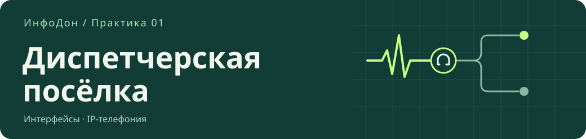

# Диспетчерская посёлка с IP-телефонией

«Вчера уже звонили про фонари. Когда починят?» Сегодня трубку взял другой диспетчер. Что ему показать, чтобы он сразу нашёл обращение, назвал исполнителя и сказал, как идут работы?

Сделайте браузерный прототип для двух смен диспетчеров. Можно работать одному или в паре. Экраны и стек выбираете сами, звонки имитируете кнопками.

**[Сделать свою копию на GitHub →](https://github.com/Shugar86/practice-village-desk/fork)**

## Как начать

1. Войдите в GitHub, откройте ссылку выше и нажмите **Create fork**. Проверьте: в адресе копии теперь ваш логин.
2. На странице **своей копии** нажмите **Code → Open with GitHub Desktop** и выберите папку на компьютере. Если пользуетесь терминалом, под **Code → HTTPS** скопируйте ссылку и выполните `git clone ВАША_СКОПИРОВАННАЯ_ССЫЛКА`.
3. Откройте в этой папке [index.html](index.html) двойным щелчком. Стартовая страница работает без установки зависимостей и интернета. В [data.js](data.js) — вымышленные жители, обращения и звонки; линии обозначены буквами.
4. Создайте рабочую ветку `practice`: **Current Branch → New Branch** в GitHub Desktop или `git switch -c practice` в каталоге проекта.

## Что показать

| Ситуация | Чем она должна закончиться |
| --- | --- |
| **Повторный звонок.** Житель с линии «ЛИНИЯ-А» спрашивает про фонари. | Диспетчер находит вчерашнее обращение, передаёт электрику и записывает результат. В истории видны оба звонка, заявка осталась одна. |
| **Новый житель.** С линии «ЛИНИЯ-В» звонят впервые. | Диспетчер создаёт карточку и новое обращение. |
| **Пропущенный.** Диспетчер занят и не успел ответить. | После обновления страницы следующая смена видит, кому перезвонить. После обратного звонка очередь освобождается, история сохраняется. |

## Как сдать

Сохраняйте работу коммитами в ветке `practice`. Перед сдачей обновите здесь инструкцию запуска, опубликуйте ветку в **своём форке** (**Publish branch** в GitHub Desktop или `git push -u origin practice`). Пришлите ссылку на ветку в своём форке или на pull request. Приложите короткое видео либо покажите сценарии по связи.

ИИ использовать можно. Покажите, какое решение вы приняли сами и почему оно удобно диспетчеру.
